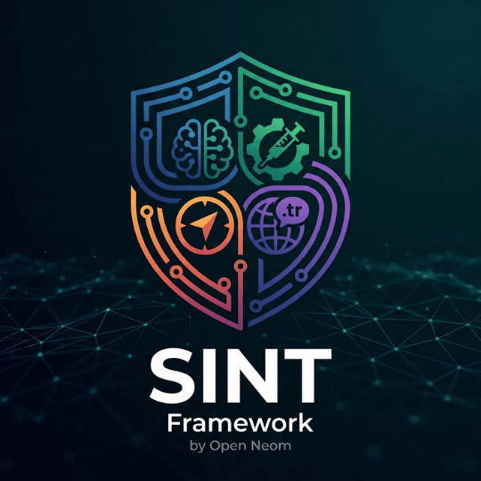

# SINT

<p align="center">
  
</p>

<p align="center">
  <strong>State · Injection · Navigation · Translation</strong><br/>
  Extreme-performance, Clean Architecture micro-framework for Flutter — battle-tested on real-time audio DAWs, 3D/VR engines, 256 Hz EEG streams, and on-device LLM inference.
</p>

<p align="center">
  <a href="https://pub.dev/packages/sint"></a>
  <a href="LICENSE"></a>
  <a href="https://github.com/sponsors/Open-Neom"></a>
</p>

<div align="center">

[](#)
[](documentation/es_ES/README.md)
[](documentation/ar_EG/README.md)
[](documentation/fr_FR/README.md)
[](documentation/pt_BR/README.md)
[](documentation/ru_RU/README.md)
[](documentation/ja_JP/README.md)
[](documentation/zh_CN/README.md)
[](documentation/kr_KO/README.md)
[](documentation/id_ID/README.md)
[](documentation/tr_TR/README.md)
[](documentation/vi_VI/README.md)

</div>

---

## The Four Pillars

SINT focuses strictly on four foundational pillars — zero HTTP clients, validators, or unrelated bloat:

| Pillar | Core APIs | Guide |
| --- | --- | --- |
| **S — State** | `SintController`, `Obx`, `ObxSelect`, `.obs`, `Sint.computed`, `Sint.batch`, `Sint.frameBatch`, `FrameThrottledRx`, `RxFuture`, `SintStatus`, `SintView` | [State Docs](documentation/en_US/state_management.md) |
| **I — Injection** | `Bind.contract`, `Bind.putContract`, `Sint.put`, `Sint.lazyPut`, `Sint.find`, `Sint.findAll`, `SintScope`, `SintService` | [Injection Docs](documentation/en_US/injection_management.md) |
| **N — Navigation** | `SintApp`, `SintPage`, `SintRoute`, `SintRouterOutlet`, `globalMiddlewares`, `Sint.toNamed`, `Sint.maybePop`, `Sint.canPop`, `Sint.pop`, `pathParams`, `queryParams` | [Navigation Docs](documentation/en_US/navigation_management.md) |
| **T — Translation** | `.tr`, `.trParams`, `Translations`, `Sint.updateLocale`, `Sint.registerLazyTranslations`, `translateEndpoints` | [Translation Docs](documentation/en_US/translation_management.md) |

---

## Battle-Tested on Extreme-Performance Platforms ([Open Neom](https://github.com/Open-Neom))

Most Flutter state/DI libraries are designed around CRUD forms. **SINT is engineered and proven in production across Open Neom's `70+` modular Clean Architecture packages**, powering applications that continuously push Flutter's frame budget to the limit:

| Production Workload | Open Neom Platforms | How SINT Keeps 60–120 FPS |
| --- | --- | --- |
| **Audio DAW, VST & Real-Time DSP** | `neom_daw`, `neom_vst`, `neom_generator`, [Cyberneom](https://cyberneom-edd2d.web.app) | `Sint.frameBatch` & `FrameThrottledRx` coalesce high-rate playheads, VU meters, and synth automation into **1 UI flush per VSync** with zero heap allocations. |
| **3D / VR & Flutter GPU Scenes** | `vrlizate`, `vrlizate_scene`, `neom_vr` | Fine-grained `Obx` / `ObxSelect` isolates HUD overlays from high-frequency camera and controller poses while `SintScope` manages multi-viewport isolation. |
| **Real-Time EEG & Biofeedback** | `neom_eeg`, `cyberneom` | 256 Hz multi-channel biosignal bursts coalesce cleanly to display refresh (`8×` fewer UI dispatches) without allocating `StreamController`s or `Timer`s. |
| **On-Device Edge AI & LLM Streaming** | [Itzli](https://itzli-app.web.app), `saia_edge`, `saia_gguf` | High-throughput token streams (50–100+ tok/s) update chat buffers cleanly via `Sint.frameBatch` while `Bind.contract` swaps local vs. cloud inference backends cleanly. |
| **Large Modular Ecosystems & Web/Wasm** | `neom_craft_workspace`, [EMXI](https://emxi-9c5b5.web.app), [Gigmeout](https://gig-me-out.web.app) | Single-element `MultiBinder` ($O(1)$ widget-tree depth), reified `Type`-keyed DI (100% Web/Wasm minification-safe), and Multi-Level Prefix Trie routing. |

---

## What's New in 2.3.0

1. **High-Frequency Real-Time UI Primitives (`Sint.frameBatch`, `FrameThrottledRx`, `ObxSelect`)**:
   - **`Sint.frameBatch(() { ... })` & `Sint.flushFrameBatch()`**: Coalesces rapid multi-tick mutations (256 Hz sensors, DAW playheads, VR poses, LLM token streams) across separate async callbacks into **at most one VSync frame flush** with zero per-tick allocations (**8× fewer UI dispatches** and **3.56× faster** than unbatched `ValueNotifier` in our 60-frame telemetry benchmark).
   - **`FrameThrottledRx<T>` (`rx.throttledToFrame()` & `controller.frameThrottled(rx)`)**: Zero-Stream, zero-Timer VSync-throttled derived signal that skips notifications when unobserved or when sub-frame jitter returns to the last emitted value (`0 → 1 → 0` emits 0 rebuilds), with automatic `onClose()` disposal on `SintController`.
   - **`ObxSelect<T>`**: Inline fine-grained selector widget (`ObxSelect(selector: ..., builder: ..., equals: ...)`) that rebuilds **only** when the projected slice changes, eliminating boilerplate `Computed` fields for complex `Rx<Model>` objects.
2. **Automated GetX → SINT Migration & 10-Rule Architectural Linter (`dart run sint:migrate` & `dart run sint:audit`)**:
   - Built-in pure-Dart CLIs (`bin/migrate.dart`, `bin/audit.dart`, zero extra dependencies) with `--dry-run`, `--apply`, `--strict`, `--fail-on-warnings`, `--rule=`, `--json` CI reporting, and inline `// sint-ignore: <code>` suppressions.
   - Rewrites `pubspec.yaml` (`get:` → `sint: ^2.3.0`) and Dart imports/symbols (`Get*` → `Sint*`, `getPages:` → `sintPages:`) safely outside comments and string literals, while auditing **10 real-world architectural rules** (`sint_no_get_connect`, `bind_put_closure_trap`, `sint_back_inside_modal`, `avoid_sint_put_in_build`, `avoid_direct_navigator`, `prefer_sint_find_or_null`, `prefer_sint_find_or_put`, `prefer_contract_binding`, `prefer_sint_batch`, and `--strict` `deprecated_flutter_ui_import`).
3. **Built-in Runtime Diagnostics, `onRebuild` Hook & VM Service Extensions (`Sint.diagnostics`)**:
   - Zero-overhead 4-pillar inspector (`Sint.diagnostics.snapshot()`, `stateSnapshot()`, `dependenciesSnapshot()`, `routesSnapshot()`, `localizationSnapshot()`).
   - Opt-in live `Obx` / `ObxSelect` rebuild hot-spot profiler (`Sint.diagnostics.enableRebuildTracking = true`, `debugLabel:`, `rebuildStats()`) plus `Sint.diagnostics.onRebuild` for external watchdogs (e.g. `sint_sentinel`'s `StateWatchdog`).
   - Automatically registers Dart VM Service Extensions (`ext.sint.getSnapshot`, `ext.sint.getDependencies`, `ext.sint.getRoutes`, `ext.sint.getLocalization`, `ext.sint.getRebuildStats`) in debug/profile builds (`!kReleaseMode`).
4. **Ecosystem Ergonomics Proven Across 70+ Open Neom Packages (`Sint.findOrPut`, `Sint.argumentsAs<T>()`, Headless-Safe Route Getters)**:
   - **`Sint.findOrPut<T>(() => ...)`**: Atomic single-lookup find-or-register honoring `SintScope` overrides (eliminates `Sint.isRegistered<T>() ? Sint.find<T>() : Sint.put(T())` boilerplate).
   - **`Sint.argumentsAs<T>()` & Headless-Safe Route Getters**: Type-safe `argumentsAs<T>()` (never throws `TypeError`) and `SintRoot`-guarded `arguments`, `parameters`, `pathParams`, `queryParams`, `routeParam`, `pathParam`, `queryParam`, and `queryParamOrDefault` so controllers work cleanly in unit tests without `try/catch` wrappers; `Sint.find` now throws a typed `StateError` (`only_throw_errors`).

### Previous 2.x Milestones

- **`2.2.2`**: Flutter 3.50 / Dart 3.14 clean static analysis (`160/160` pub points readiness), decoupled 49 legacy SDK material/cupertino imports, leak-free `Sint.snackbar()`, `const` transitions, standalone `SintAppBar` parity, and `Bind.put` dynamic-type hardening.
- **`2.2.1`**: Full `Navigator`-free APIs (`Sint.maybePop`, `Sint.canPop`, safe `Sint.pop`), automatic `MaterialApp`/`CupertinoApp` widget-test fallback via `Sint.resolveNavigator`, and synchronous snackbar queue cancellation.
- **`2.2.0`**: Single-element `MultiBinder` ($O(1)$ widget depth), glitch-free & lazy `Computed`, single-slot `Obx`, reactive `.tr` with zero-reassemble `Sint.updateLocale`, unified Navigator 2.0 `SintMiddleware` guards, `Sint.putContractAsync`, `package:sint/rx.dart`, and [`llms.txt`](llms.txt).
- **`2.1.0`**: Contract-first DI (`Bind.contract` / `Bind.putContract` / `aliases:`), `SintScope`, zero-Stream synchronous workers, `ValueListenable` interop, `RxFuture<T>` + sealed `SintStatus<T>`, `globalMiddlewares`, typed `SintRoute<TArgs, TResult>`, and $O(1)$ pre-resolved locale cache.
- **`2.0.0`**: Standalone design systems (`SintApp` for `material_ui` / `cupertino_ui`), incremental $O(1)$ `Obx` + `Sint.batch` + `Sint.computed`, Multi-Level Prefix Trie router (**97.8× speedup**), and `SintRouterOutlet`.

---

## Quick Start

```yaml
dependencies:
  sint: ^2.3.0
```

```dart
import 'package:flutter/widgets.dart';
import 'package:material_ui/material_ui.dart';
import 'package:sint/sint.dart';

class TelemetryController extends SintController {
  final sampleHz = 0.obs;
  final channel = 'Fp1'.obs;

  // VSync-throttled derived signal (auto-disposed on route close)
  late final uiSample = frameThrottled(sampleHz);
  late final label = computed(() => '${channel.value}: ${uiSample.value} Hz');

  /// Called at 256 Hz from a native DSP/EEG/WebSocket callback:
  void onHardwarePacket(int hz) => Sint.frameBatch(() {
    sampleHz.value = hz; // Coalesced to 1 UI flush per VSync frame!
  });
}

void main() => runApp(
  SintApp(
    materialTheme: ThemeData(),
    initialRoute: '/',
    sintPages: [
      SintPage(
        name: '/',
        binds: [Bind.put(TelemetryController())],
        page: () {
          final c = Sint.find<TelemetryController>();
          return Scaffold(
            body: Center(
              child: Obx(
                () => Text(c.label.value),
                debugLabel: 'telemetry-readout',
              ),
            ),
            floatingActionButton: FloatingActionButton(
              onPressed: () => c.onHardwarePacket(c.sampleHz.peek + 1),
              child: const Text('+'),
            ),
          );
        },
      ),
    ],
  ),
);
```

### 30-Second Golden Rules

| Scenario | Recommended SINT 2.3 Idiom | Why |
| --- | --- | --- |
| **Dismiss dialog / bottom sheet** | `Sint.pop(result)` | Pops the active overlay without accidentally popping the underlying page route. |
| **Pop a page route** | `Sint.back(result: value)` or `Sint.maybePop(value)` | Honors `PopScope` and safely handles root routes. |
| **Bind interface + controller** | `Bind.contract<AuthService, AuthController>(() => AuthController(), fenix: true)` | Single shared factory; eliminates manual 2-line closure bridges. |
| **Multi-field synchronous update** | `Sint.batch(() { a.value = 1; b.value = 2; })` | Recomputes `Computed` and rebuilds `Obx` once instead of $N$ times. |
| **High-frequency stream (60–1000 Hz)** | `Sint.frameBatch(...)` or `controller.frameThrottled(rx)` | Caps UI notifications at display VSync with zero `Stream`/`Timer` allocations. |
| **Slice of a complex `Rx<Model>`** | `ObxSelect(selector: () => m.value.field, builder: ...)` | Rebuilds only when the selected field changes. |

---

## Architectural Positioning & Benchmarks

### Why SINT 2.x is Not GetX (And Why Context-Free is Clean Architecture)

GetX was criticized for bundling unrelated utilities (`GetConnect` HTTP/sockets, string validators), using `Type.toString()` keys that broke under Web/Wasm minification, leaking conditional `Obx` listeners, and lacking batching or computed signals. **SINT replaces those internals completely** with:

1. **Strict 4-Pillar Scope (`S · I · N · T`)**: Clean Architecture boundaries (`domain`, `engine`, `router`, `ui`) with zero unrelated bloat.
2. **Reified `Type`-Keyed DI & $O(M)$ Route Teardown**: Safe under Web/Wasm minification; route-owned controllers, `computed`, and `frameThrottled` signals auto-dispose deterministically on route pop.
3. **Zero-Stream Synchronous & VSync Signals**: `StreamController` is allocated lazily only if `.stream`/`.listen` is accessed; `Obx`, `ObxSelect`, `Computed`, `Sint.batch`, `Sint.frameBatch`, and `ever` run on synchronous pointer lists.
4. **Why Context-Free APIs (`Sint.toNamed`, `Sint.find`, `.tr`) Are Safe by Design**: Navigation, overlays, and localization belong to the root application host, not leaf widgets. Threading `BuildContext` into controllers or async callbacks couples domain logic to the UI tree and triggers `use_build_context_synchronously` bugs after `await` gaps.

### Solving the 4 Pillars: Engineering Velocity & Audit Surface

Building an equivalent 4-pillar feature (Reactive State + Derived Value + Scoped DI + Parameterized Route + i18n + Snackbar):

| Dimension | **SINT 2.3** | **BLoC Stack** (`bloc` + `get_it` + `go_router` + `intl`) | **Riverpod Stack** (`riverpod` + `go_router` + `intl`) | **Provider Stack** (`provider` + `go_router` + `intl`) | **Legacy GetX** |
| --- | --- | --- | --- | --- | --- |
| **Packages to Maintain & Audit** | **1 (`sint`)** | 5+ external packages | 4+ packages + `build_runner` | 4+ external packages | 1 (bloated with HTTP/utils) |
| **Files Touched per Feature** | **1–2 files** | 5–6 files | 4–5 files (`.g.dart`, `.arb`) | 4 files | 1–2 files |
| **Codegen (`build_runner`)** | **0 generated files** | Optional (`freezed`/`injectable`) + ARB | Required (`.g.dart` + ARB) | ARB codegen | 0 generated files |
| **Feature Boilerplate (LoC)** | **~35 LoC** | **~165 LoC** *(4.7× more)* | **~115 LoC** *(3.3× more)* | **~105 LoC** *(3.0× more)* | ~40 LoC |
| **High-Frequency Frame Coalescing** | **Native (`Sint.frameBatch`, `FrameThrottledRx`, `ObxSelect`)** | Manual RxDart / debounce | Manual `select` / stream throttle | Manual throttle + `Selector` | None |
| **DI ↔ Router Lifecycle (I ↔ N)** | **Native ($O(M)$ auto-dispose on route pop)** | Manual `BlocProvider` / `GetIt` | Coupled to widget unmount | Coupled to `BuildContext` | $O(N \times M)$ scan / string keys |
| **Route Matching (N)** | **Multi-Level Prefix Trie ($O(\text{depth})$)** | External (`go_router`) | External (`go_router`) | External (`go_router`) | Linear / 1st-segment regex |
| **Flutter 3.47+ Standalone UI** | **Native (`SintApp`)** | Manual host setup | Manual host setup | Manual host setup | Unsupported |

### Verified Benchmarks ([`four_pillars_benchmark_test.dart`](test/benchmarks/four_pillars_benchmark_test.dart) · [`high_frequency_benchmark_test.dart`](test/benchmarks/high_frequency_benchmark_test.dart))

| Workload | SINT 2.3 Median | Baseline / Alternative Median | Result |
| --- | ---: | ---: | --- |
| **Pillar S (High-Frequency)** — 60 Frames × 8 Bursts/Frame (256–480 Hz) × 50 Subscribers | **`20.6 µs`** (`Sint.frameBatch`, 3,000 dispatches)<br/>**`39.6 µs`** (`FrameThrottledRx`, 3,000 dispatches) | `73.3 µs` (`ValueNotifier`, 24,000 dispatches)<br/>`74.8 µs` (Unbatched `Rx`, 24,000 dispatches) | **8× fewer UI dispatches**<br/>**3.56× faster** (`Sint.frameBatch`) · **1.85× faster** (`FrameThrottledRx`) |
| **Pillar S (Transaction)** — 20-Widget Screen, 4-Field Update + Derived Total | **`0.23 µs/op`** (`Sint.batch` + `Computed`) | `0.37 µs/op` (Unbatched `Rx`)<br/>`0.90 µs/op` (`ChangeNotifier`)<br/>`1.02 µs/op` (Immutable State Copy) | **1.6× faster** than unbatched `Rx`<br/>**4.0× – 4.5× faster** than `ChangeNotifier` / `BLoC` |
| **Pillar N** — 1,000 Shared-Prefix Routes (`/api/item999/:id`) | **`2.56 µs/op`** (Multi-Level Trie) | `250.48 µs/op` (1st-segment / linear regex scan) | **97.8× faster** ($O(\text{depth})$ constant scaling) |
| **Pillar I** — Hot Typed/Tagged Dependency Lookup (`Sint.find<T>`) | **`0.021 µs/op`** (Reified `Type` registry) | — | **~47M lookups/sec** (Web/Wasm minification-safe) |
| **Full S·I·N·T Cycle** (Route Match + `Sint.find` + `batch`/`computed` + `.trParams`) | **`3.57 µs/op`** | — | **~280,000 complete 4-pillar cycles/sec** |

---

## Migrating from GetX in 60 Seconds

Use the built-in CLI to preview and apply a safe migration + architectural audit:

```bash
# 1. Preview every change & architectural finding without touching disk:
dart run sint:migrate . --dry-run

# 2. Apply pubspec.yaml and Dart symbol rewrites (Get* -> Sint*, getPages -> sintPages):
dart run sint:migrate . --apply

# 3. Run read-only architectural linting in CI (10 rules, exits 1 on warnings):
dart run sint:audit . --fail-on-warnings --strict

# 4. Export JSON diagnostics for CI pipelines:
dart run sint:audit . --json
```

> **Zero-breaking-change compatibility in `2.x`**: All `@Deprecated` `Get*` aliases (`Get`, `GetxController`, `GetMaterialApp`, `GetPage`, `GetBuilder`, `GetRouterOutlet`) remain functional throughout `2.x` so teams can migrate incrementally before `3.0.0`.

---

## Runtime Diagnostics (`Sint.diagnostics`)

Inspect all four pillars live in debug/profile mode with zero release overhead:

```dart
// 1. Profile Obx / ObxSelect rebuild hot-spots:
Sint.diagnostics.enableRebuildTracking = true;
print(Sint.diagnostics.rebuildStats()); // Ordered descending by rebuild count

// 2. Capture a unified JSON-serializable 4-pillar snapshot:
final snapshot = Sint.diagnostics.snapshot();
```

In debug and profile builds (`!kReleaseMode`), `SintRoot` automatically registers five Dart VM Service Extensions (`ext.sint.getSnapshot`, `ext.sint.getDependencies`, `ext.sint.getRoutes`, `ext.sint.getLocalization`, `ext.sint.getRebuildStats`) for Flutter DevTools and custom telemetry dashboards.

---

## Documentation & Resources

- **Pillar Guides**: [State](documentation/en_US/state_management.md) · [Injection](documentation/en_US/injection_management.md) · [Navigation](documentation/en_US/navigation_management.md) · [Translation](documentation/en_US/translation_management.md)
- **AI Coding Assistant Reference**: [llms.txt](llms.txt)
- **Standalone Material / Cupertino Migration**: [MIGRATION_DESIGN_SYSTEMS.md](MIGRATION_DESIGN_SYSTEMS.md)
- **Large GetX App Migration Guide**: [docs/MIGRATING_LARGE_GETX_APPS.md](docs/MIGRATING_LARGE_GETX_APPS.md)
- **Benchmarks & Methodology**: [test/benchmarks/README.md](test/benchmarks/README.md) · [performance/README.md](performance/README.md)
- **Release History & Roadmap**: [CHANGELOG.md](CHANGELOG.md) · [ROADMAP.md](ROADMAP.md)

---

## Supporting SINT

SINT is MIT-licensed and maintained by [Open Neom](https://github.com/Open-Neom), where it powers `70+` Clean Architecture packages across audio DSP, VR/3D, neurotech/EEG, edge AI, and cross-platform Web/Wasm apps ([EMXI](https://emxi-9c5b5.web.app), [Gigmeout](https://gig-me-out.web.app), [Cyberneom](https://cyberneom-edd2d.web.app), [Itzli](https://itzli-app.web.app)).

If SINT saves engineering time for you or your team, consider supporting ongoing development through [**GitHub Sponsors**](https://github.com/sponsors/Open-Neom).

---

## License

Released under the [MIT License](LICENSE). Part of the [Open Neom](https://github.com/Open-Neom) ecosystem.
