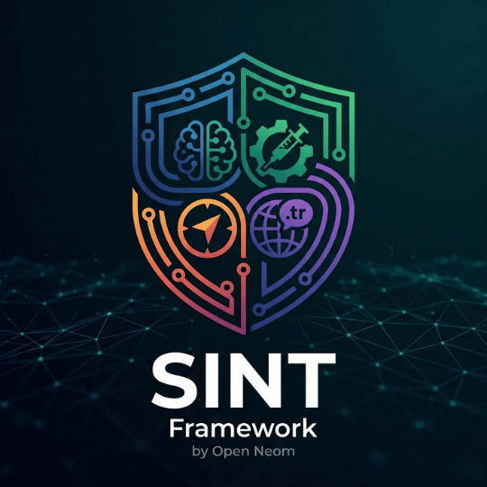

# SINT

<p align="center">
  
</p>

<p align="center">
  <strong>State · Injection · Navigation · Translation</strong><br/>
  Micro-framework de rendimiento extremo y Clean Architecture para Flutter — probado en producción en DAWs de audio, motores 3D/VR, señales EEG a 256 Hz e inferencia LLM en dispositivo.
</p>

<p align="center">
  <a href="https://pub.dev/packages/sint"></a>
  <a href="../../LICENSE"></a>
  <a href="https://github.com/sponsors/Open-Neom"></a>
</p>

---

## Los Cuatro Pilares

SINT se enfoca estrictamente en cuatro pilares fundamentales — sin clientes HTTP, validadores ni código innecesario:

| Pilar | APIs Principales | Guía |
| --- | --- | --- |
| **S — State** | `SintController`, `Obx`, `ObxSelect`, `.obs`, `Sint.computed`, `Sint.batch`, `Sint.frameBatch`, `FrameThrottledRx`, `RxFuture`, `SintStatus`, `SintView` | [Documentación de Estado](state_management.md) |
| **I — Injection** | `Bind.contract`, `Bind.putContract`, `Sint.put`, `Sint.lazyPut`, `Sint.find`, `Sint.findAll`, `SintScope`, `SintService` | [Documentación de Inyección](injection_management.md) |
| **N — Navigation** | `SintApp`, `SintPage`, `SintRoute`, `SintRouterOutlet`, `globalMiddlewares`, `Sint.toNamed`, `Sint.maybePop`, `Sint.canPop`, `Sint.pop`, `pathParams`, `queryParams` | [Documentación de Navegación](navigation_management.md) |
| **T — Translation** | `.tr`, `.trParams`, `Translations`, `Sint.updateLocale`, `Sint.registerLazyTranslations`, `translateEndpoints` | [Documentación de Traducción](translation_management.md) |

---

## Probado al Límite en Plataformas de Alto Rendimiento ([Open Neom](https://github.com/Open-Neom))

La mayoría de librerías de estado en Flutter están pensadas para formularios CRUD. **SINT está diseñado y validado en producción a través de los más de `70` módulos modulares de Open Neom**, donde las plataformas llevan el presupuesto de frames de Flutter al límite real:

| Carga de Producción | Plataformas Open Neom | Cómo SINT Sostiene 60–120 FPS |
| --- | --- | --- |
| **Audio DAW, VST y DSP en Tiempo Real** | `neom_daw`, `neom_vst`, `neom_generator`, [Cyberneom](https://cyberneom-edd2d.web.app) | `Sint.frameBatch` y `FrameThrottledRx` agrupan playheads, medidores VU y automatización DSP en **1 solo flush por VSync** sin asignaciones en heap. |
| **Escenas 3D / VR y Flutter GPU** | `vrlizate`, `vrlizate_scene`, `neom_vr` | `Obx` y `ObxSelect` aíslan los HUDs frente a telemetría de cámara/controladores de alta tasa, mientras `SintScope` aísla múltiples viewports. |
| **EEG en Tiempo Real y Biofeedback** | `neom_eeg`, `cyberneom` | Ráfagas multicanal de 256 Hz se agrupan limpiamente al refresco de pantalla (**8× menos dispatches a UI**) sin crear `StreamController`s ni `Timer`s. |
| **IA Local (Edge AI) y Streaming LLM** | [Itzli](https://itzli-app.web.app), `saia_edge`, `saia_gguf` | Flujos de 50–100+ tokens/s actualizan buffers de chat sin jank mediante `Sint.frameBatch`, mientras `Bind.contract` intercambia motores locales o en la nube. |
| **Ecosistemas Modulares y Web/Wasm** | `neom_craft_workspace`, [EMXI](https://emxi-9c5b5.web.app), [Gigmeout](https://gig-me-out.web.app) | `MultiBinder` de un solo `Element` ($O(1)$ de profundidad), DI por `Type` reificado (100% seguro ante minificación Web/Wasm) y Router Trie Multinivel. |

---

## Novedades en 2.3.0

1. **Primitivas Reactivas de Alta Frecuencia (`Sint.frameBatch`, `FrameThrottledRx`, `ObxSelect`)**:
   - **`Sint.frameBatch(() { ... })` y `Sint.flushFrameBatch()`**: Agrupa mutaciones rápidas que llegan en múltiples ticks (sensores 256 Hz, playheads DAW, poses VR, tokens LLM) en **como máximo un flush alineado a VSync** con cero asignaciones por tick (**8× menos dispatches** y **3.56× más rápido** que `ValueNotifier` sin agrupar).
   - **`FrameThrottledRx<T>` (`rx.throttledToFrame()` y `controller.frameThrottled(rx)`)**: Señal derivada alineada a VSync sin `Stream` ni `Timer` que omite notificaciones si no hay listeners o si el jitter sub-frame regresa al último valor emitido (`0 → 1 → 0` emite 0 rebuilds), con auto-dispose en `SintController.onClose()`.
   - **`ObxSelect<T>`**: Widget selector fino inline (`ObxSelect(selector: ..., builder: ..., equals: ...)`) que reconstruye **solo** cuando cambia la porción proyectada.
2. **CLI de Migración y Linter Arquitectónico de 10 Reglas (`dart run sint:migrate` y `dart run sint:audit`)**:
   - CLIs en Dart puro (`bin/migrate.dart` y `bin/audit.dart`, cero dependencias nuevas) con `--dry-run`, `--apply`, `--strict`, `--fail-on-warnings`, `--rule=`, `--json` y supresión inline `// sint-ignore: <code>`.
   - Reescribe `pubspec.yaml` (`get:` → `sint: ^2.3.0`) y símbolos/imports Dart (`Get*` → `Sint*`, `getPages:` → `sintPages:`), además de auditar **10 reglas reales**: `sint_no_get_connect`, `bind_put_closure_trap`, `sint_back_inside_modal`, `avoid_sint_put_in_build`, `avoid_direct_navigator`, `prefer_sint_find_or_null`, `prefer_sint_find_or_put`, `prefer_contract_binding`, `prefer_sint_batch` y `deprecated_flutter_ui_import` (`--strict`).
3. **Diagnóstico en Tiempo de Ejecución, Hook `onRebuild` y VM Service Extensions (`Sint.diagnostics`)**:
   - Inspector unificado de los 4 pilares (`Sint.diagnostics.snapshot()`, `stateSnapshot()`, `dependenciesSnapshot()`, `routesSnapshot()`, `localizationSnapshot()`).
   - Perfilador opcional de hot-spots de rebuilds `Obx` / `ObxSelect` (`enableRebuildTracking`, `debugLabel:`, `rebuildStats()`) más el hook `Sint.diagnostics.onRebuild` para integrarse sin acoplamiento con watchdogs externos (como `sint_sentinel`).
   - Registro automático de extensiones VM Service (`ext.sint.*`) en debug/profile (`!kReleaseMode`).
4. **Ergonomía Validada en 70+ Módulos Open Neom (`Sint.findOrPut`, `Sint.argumentsAs<T>()` y Getters Seguros sin `SintRoot`)**:
   - `Sint.findOrPut<T>(() => ...)` reemplaza `Sint.isRegistered<T>() ? Sint.find<T>() : Sint.put(T())` en una sola búsqueda `O(1)` respetando `SintScope`.
   - `Sint.argumentsAs<T>()` ofrece lectura tipada sin crashes `TypeError`, y `arguments`/`parameters`/`pathParams`/`queryParams` devuelven valores seguros cuando `SintRoot` no está montado en tests headless.

---

## Inicio Rápido

```yaml
dependencies:
  sint: ^2.3.0
```

```dart
import 'package:flutter/widgets.dart';
import 'package:material_ui/material_ui.dart';
import 'package:sint/sint.dart';

class TelemetryController extends SintController {
  final sampleHz = 0.obs;
  final channel = 'Fp1'.obs;

  late final uiSample = frameThrottled(sampleHz);
  late final label = computed(() => '${channel.value}: ${uiSample.value} Hz');

  /// Invocado a 256 Hz desde un callback nativo DSP/EEG/WebSocket:
  void onHardwarePacket(int hz) => Sint.frameBatch(() {
    sampleHz.value = hz; // Agrupado en 1 solo flush de UI por frame VSync
  });
}
```

---

## Benchmarks Verificados ([`four_pillars_benchmark_test.dart`](../../test/benchmarks/four_pillars_benchmark_test.dart) · [`high_frequency_benchmark_test.dart`](../../test/benchmarks/high_frequency_benchmark_test.dart))

| Carga de Trabajo | Mediana SINT 2.3 | Mediana Alternativa / Línea Base | Resultado |
| --- | ---: | ---: | --- |
| **Pilar S (Alta Frecuencia)** — 60 Frames × 8 Ráfagas/Frame × 50 Suscriptores | **`20.6 µs`** (`Sint.frameBatch`, 3,000 dispatches)<br/>**`39.6 µs`** (`FrameThrottledRx`, 3,000 dispatches) | `73.3 µs` (`ValueNotifier`, 24,000 dispatches)<br/>`74.8 µs` (`Rx` sin batch, 24,000 dispatches) | **8× menos dispatches a UI**<br/>**3.56× más rápido** (`Sint.frameBatch`) · **1.85× más rápido** (`FrameThrottledRx`) |
| **Pilar S (Transacción)** — Pantalla de 20 Widgets, 4 Campos + Total Derivado | **`0.23 µs/op`** (`Sint.batch` + `Computed`) | `0.37 µs/op` (`Rx` sin batch)<br/>`0.90 µs/op` (`ChangeNotifier`)<br/>`1.02 µs/op` (Copia Inmutable) | **1.6× más rápido** que `Rx` sin batch<br/>**4.0× – 4.5× más rápido** que `ChangeNotifier` / `BLoC` |
| **Pilar N** — 1,000 Rutas con Prefijo Compartido (`/api/item999/:id`) | **`2.56 µs/op`** (Trie Multinivel) | `250.48 µs/op` (Escaneo regex 1er segmento / lineal) | **97.8× más rápido** (escalado constante $O(\text{depth})$) |
| **Pilar I** — Búsqueda Caliente Tipada (`Sint.find<T>`) | **`0.021 µs/op`** (Registro `Type` reificado) | — | **~47M búsquedas/seg** (seguro en Web/Wasm) |
| **Ciclo Completo S·I·N·T** | **`3.57 µs/op`** | — | **~280,000 ciclos completos/seg** |

---

## Migración desde GetX en 60 Segundos

```bash
# Vista previa segura sin modificar archivos:
dart run sint:migrate . --dry-run

# Aplicar migración de pubspec.yaml y símbolos Get* -> Sint*:
dart run sint:migrate . --apply

# Exportar diagnóstico JSON para CI:
dart run sint:migrate . --json
```

> **Compatibilidad sin breaking changes en `2.x`**: Todos los alias `@Deprecated` (`Get`, `GetxController`, `GetMaterialApp`, `GetPage`, `GetBuilder`, `GetRouterOutlet`) permanecen operativos durante todo `2.x` antes de `3.0.0`.

---

## Documentación y Recursos

- **Guías por Pilar**: [Estado](state_management.md) · [Inyección](injection_management.md) · [Navegación](navigation_management.md) · [Traducción](translation_management.md)
- **Referencia para Asistentes IA**: [llms.txt](../../llms.txt)
- **Migración Material / Cupertino Standalone**: [MIGRATION_DESIGN_SYSTEMS.md](../../MIGRATION_DESIGN_SYSTEMS.md)
- **Benchmarks y Metodología**: [test/benchmarks/README.md](../../test/benchmarks/README.md) · [performance/README.md](../../performance/README.md)
- **Historial y Roadmap**: [CHANGELOG.md](../../CHANGELOG.md) · [ROADMAP.md](../../ROADMAP.md)
